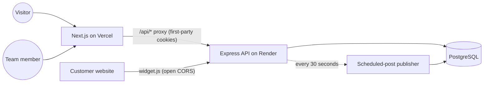

# LaunchNote

Changelog, public roadmap and feedback board for software products, with an embeddable
"What's new" widget. A small, self-built version of tools like Canny or Headway.

**Live demo:** <your-vercel-url> &nbsp;|&nbsp; **Demo login:** `<demo-email>` / `<demo-password>`

<!-- Add screenshots to a /docs folder, then uncomment these lines -->
<!--


-->

## Features

- **Changelog**: rich-text editor (Tiptap), categories, drafts, scheduled publishing, public pages with SEO metadata, RSS feed
- **Feedback board**: anonymous submissions, one-vote-per-visitor upvoting, comments, team replies, status workflow
- **Roadmap**: drag-and-drop board for admins, server-rendered public roadmap, "shipped in" links to changelog posts
- **Widget**: one `<script>` tag adds a "What's new" popup with an unread indicator (Shadow DOM, no style clashes)
- **Analytics**: page views, unique visitors, widget opens and clicks, top posts and top ideas (no IP addresses stored)
- **Teams and roles**: owner / admin / member permissions, single-use invite links, ownership transfer
- **Multi-tenant**: every query is scoped to the project the user belongs to
- **Marketing site**: landing page and a demonstration pricing page

## Tech stack

| Layer | Tools |
|---|---|
| Web | Next.js (App Router), React, TypeScript, Tailwind CSS, shadcn/ui, TanStack Query, Tiptap |
| API | Node.js, Express 5, TypeScript, Zod, helmet, JWT in httpOnly cookies |
| Data | PostgreSQL, Prisma |
| Ops | GitHub Actions CI, Vercel (web), Render (API), Neon (database) |

## Architecture



## Engineering decisions worth a look

- **Safe rich text.** Editor HTML is sanitized on the server with an allowlist before it is stored, so published content cannot inject scripts.
- **Anonymous voting.** A per-browser UUID plus a database unique constraint gives one vote per visitor per idea. Vote and comment counters are updated inside transactions, so lists sort fast without counting rows.
- **Job scheduling without Redis.** Scheduled posts are published by polling an indexed table. Each post is claimed with a conditional `UPDATE ... WHERE status = 'SCHEDULED'`, so it can never be published twice, even with several API instances. On startup the scheduler catches up on anything that came due while the API was off.
- **Role-based access.** One `requireProjectRole(...)` middleware guards every project route. Outsiders get `404`, not `403`, so project slugs cannot be discovered.
- **Invites.** 192-bit random tokens, only the SHA-256 hash is stored, links are single-use and expire after 7 days. Accepting is a claim-then-insert transaction, so two clicks cannot use one link twice.
- **Safe redirects.** The `?next=` parameter after login is validated, which prevents open-redirect attacks.
- **Embeddable widget.** Built inside a Shadow DOM, uses `textContent` only (no HTML injection) and has its own open-CORS routes, separate from the credentialed API.
- **First-party cookies in production.** The web app proxies `/api/*` to the API, so auth cookies keep working in browsers that block third-party cookies.
- **Privacy.** Analytics use anonymous random IDs. No IP addresses or personal data are stored.
- **Public vs private APIs.** `/public/*` needs no login and only returns published data. Emails and internal fields are never exposed there.

## Roles

| Action | Owner | Admin | Member |
|---|:---:|:---:|:---:|
| View dashboard, write drafts, reply to feedback | Yes | Yes | Yes |
| Publish, schedule and edit live posts | Yes | Yes | No |
| Change idea status, move roadmap cards, delete ideas | Yes | Yes | No |
| Invite members | Yes | Yes (members only) | No |
| Remove members | Yes | Members only | No |
| Change roles, transfer ownership, delete project | Yes | No | No |
| Leave the project | No (transfer first) | Yes | Yes |

## Project structure

```
launchnote/
├── api/
│   ├── prisma/schema.prisma      # data model and migrations
│   ├── public/widget.js          # the embeddable widget script
│   └── src/
│       ├── index.ts              # app setup, CORS, routes, scheduler
│       ├── lib/                  # prisma client, scheduler, sanitizer, rate limits, tokens
│       ├── middleware/           # auth, errors, requireProjectRole
│       └── routes/               # auth, projects, posts, feedback, roadmap,
│                                 # analytics, members, invites, public, embed, track
├── web/
│   └── src/
│       ├── app/                  # pages: landing, pricing, auth, dashboard, /p/[slug], /invite
│       ├── components/           # dashboard, changelog editor, feedback, public, marketing
│       └── lib/                  # API client, React Query hooks, helpers
└── .github/workflows/ci.yml      # build checks for api and web
```

## Run it locally

Requirements: Node 20+ and PostgreSQL (for example with pgAdmin).

1. Create an empty database called `launchnote`.
2. Set up the API:

```bash
cd api
cp .env.example .env        # Windows PowerShell: Copy-Item .env.example .env
# edit .env: set DATABASE_URL and JWT_SECRET
npm install
npx prisma migrate dev
npm run dev                 # http://localhost:4000
```

3. Set up the web app in a second terminal:

```bash
cd web
cp .env.example .env.local  # Windows PowerShell: Copy-Item .env.example .env.local
npm install
npm run dev                 # http://localhost:3000
```

4. Open http://localhost:3000, create an account and create your first project.

Generate a strong `JWT_SECRET` with:

```bash
node -e "console.log(require('crypto').randomBytes(48).toString('hex'))"
```

## Try the widget locally

Create a file called `widget-test.html` anywhere on your computer, replace `your-slug` with your project's slug, and open it in a browser:

```html
<!doctype html>
<html>
<head><meta charset="utf-8"><title>My product website</title></head>
<body style="font-family: sans-serif; padding: 40px">
  <h1>My product website</h1>
  <script
    src="http://localhost:4000/widget.js"
    data-project="your-slug"
    data-color="#4f46e5"
    data-position="bottom-right"
    data-label="What's new"
    defer
  ></script>
</body>
</html>
```

Optional attributes: `data-position="bottom-left"`, and `data-trigger="#my-button"` to open the popup from your own button instead of the floating one.

## Environment variables

| Where | Name | Purpose |
|---|---|---|
| API | `DATABASE_URL` | PostgreSQL connection string |
| API | `JWT_SECRET` | Signs login tokens |
| API | `CLIENT_URL` | Web app URL (CORS and widget links) |
| API | `PORT` | Port to listen on (default 4000) |
| Web | `NEXT_PUBLIC_API_URL` | `http://localhost:4000` locally, `/api` in production |
| Web | `API_ORIGIN` | Real API URL (server-side fetches and the `/api` proxy). Production only |
| Web | `NEXT_PUBLIC_WIDGET_URL` | Real API URL shown in the widget install snippet. Production only |

## API overview

| Prefix | Auth | Purpose |
|---|---|---|
| `/auth` | Public / cookie | Register, login, logout, current user |
| `/projects` | Login | Projects and nested `posts`, `feedback`, `roadmap`, `analytics`, `members` |
| `/invites` | Public preview, login to accept | Invite links |
| `/public/:slug/...` | None | Published changelog, feedback board, roadmap, page-view tracking |
| `/embed/:slug/...` and `/widget.js` | None, open CORS | Used by the widget on any website |

## Deploy

| Part | Service | Notes |
|---|---|---|
| Database | Neon | Use the direct connection string (not the pooled one) with `?sslmode=require` |
| API | Render | Root `api`. Build: `npm install --include=dev && npx prisma generate && npm run build`. Start: `npx prisma migrate deploy && node dist/index.js`. Health check: `/health` |
| Web | Vercel | Root `web`. Set `NEXT_PUBLIC_API_URL=/api`, `API_ORIGIN` and `NEXT_PUBLIC_WIDGET_URL` before the first build |

Set the API's `CLIENT_URL` to your Vercel URL and redeploy the API. Free-tier limits and menus change often, so check each provider's current docs.

## Known limitations

- Rate limiting is in-memory (per API instance). A shared store such as Redis would be the next step.
- No email: invites are shared as links, and there are no email notifications or subscribers.
- Pricing is a demonstration page. No payments are processed and every account has full access.
- On a free hosting tier the API may sleep, which delays scheduled posts until it wakes up.
- Your own visits to the public pages are counted in analytics.

## Possible next steps

- Email subscribers and notifications when a post is published
- Redis-backed rate limiting and a job queue
- Custom domains for public pages
- Automated tests (API integration tests and Playwright end-to-end tests)
- Billing with Stripe
